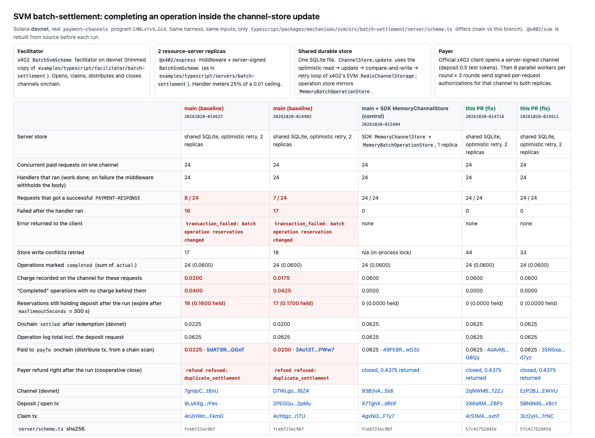
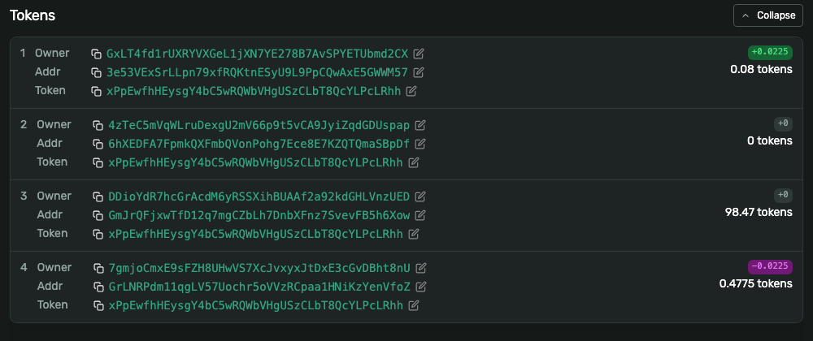
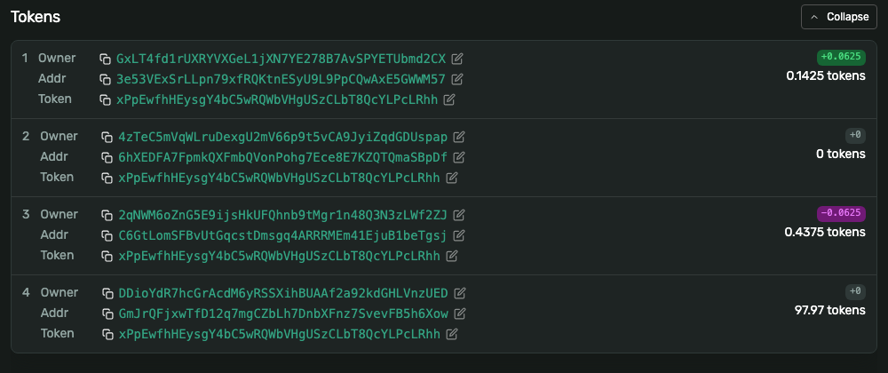

# Evidence: SVM batch-settlement charge commit

Supporting evidence for the fix on branch `fix/svm-batch-retry-safe-charge-commit`
(commit `a409a72`). This branch holds only evidence and the harness; none of it is part
of the PR.

**The issue.** In server-signed SVM batch-settlement, `commitCharge` calls
`operationStore.complete` inside the `ChannelStore.update` callback, so a store that
re-runs the callback after a write conflict, or whose write fails after the callback
ran, aborts valid charges and leaves `completed` operations with no charge behind them.
The fix completes the operation once, after the channel commit.

## Solana devnet

Real `payment-channels` program (`CHNLxYvV…GsX`), worthless test mint. Same harness and
inputs for every run; only `typescript/packages/mechanisms/svm/src/batch-settlement/server/scheme.ts`
differs (main `fcebf21e…` vs fix `57c41752…`), and `@x402/svm` is rebuilt before each run.

| | main | main | main, SDK `MemoryChannelStore` (control) | fix | fix |
|---|---|---|---|---|---|
| successful paid requests | **8/24** | **7/24** | 24/24 | 24/24 | 24/24 |
| error | `batch operation reservation changed` | same | – | – | – |
| operations marked completed (sum) | 0.0600 | 0.0600 | 0.0600 | 0.0600 | 0.0600 |
| charge on the channel for them | **0.0200** | **0.0175** | 0.0600 | 0.0600 | 0.0600 |
| paid to `payTo` onchain | **0.0225** | **0.0200** | 0.0625 | 0.0625 | 0.0625 |
| reservations held afterwards (300 s) | 16 | 17 | 0 | 0 | 0 |
| payer's immediate cooperative close | refused | refused | closed | closed | closed |

Onchain amounts include a 0.0025 charge on the deposit request.

Solana Explorer, distribute transaction token balances. On main the publisher receives
0.0225; with the fix it receives 0.0625:

| main ([5dAT9R…](https://explorer.solana.com/tx/5dAT9Re89nYYtGgGVM5yV6DYpdJbdqRokNq4urfw86mJgK862NY3q9Hrxfuj2ZiRqXQr3YEUKGb5NUumnnHNGGoT?cluster=devnet)) | fix ([4oAvMj…](https://explorer.solana.com/tx/4oAvMjCFjjpfYpmApxGpedy1jLrLorrr4BrF2voztYeMVPoBxt5bHGYCkp2K6c6y33qFh3RHNWZWNqGfHYgsG8Qy?cluster=devnet)) |
|---|---|
|  |  |

Full page: [screenshots/full.png](screenshots/full.png). Per-run data, including every
request's outcome and all transaction links, is in [`runs/`](runs), [`summary.json`](summary.json)
and [`payouts.json`](payouts.json).

### Setup

- **Facilitator:** `BatchSvmScheme` facilitator on devnet, trimmed from
  `examples/typescript/facilitator/batch-settlement`.
- **Two resource-server replicas:** `@x402/express` with server-signed `BatchSvmScheme`,
  as in `examples/typescript/servers/batch-settlement`. The handler meters 25% of a 0.01
  ceiling.
- **Shared store:** one SQLite file. `ChannelStore.update` uses the optimistic loop of
  x402's EVM `RedisChannelStorage` (read, run the updater, compare-and-write, retry). The
  operation store has `MemoryBatchOperationStore` semantics.
- **Payer:** the official x402 client opens a server-signed channel with a 0.5 deposit.
  Then 8 parallel workers per round, for 3 rounds, send SDK-signed
  (`signBatchAuthorization`) per-request authorizations for that channel to both
  replicas.
- **Settlement:** replica A's redemption worker claims and distributes onchain. The
  official client then requests a cooperative refund.

## Go (local, no chain)

[`go/concurrent_cas_test.go.txt`](go/concurrent_cas_test.go.txt) settles 24 server-mode
charges from parallel goroutines through an in-memory compare-and-set `ChannelStore`.
[`go/output.txt`](go/output.txt) has 3 runs each under `go test -race`:

- **main:** 19–20 of 24 fail with `batch operation reservation changed`, and the channel
  holds 1000–1250 against 6000 of completed operations.
- **fix:** 0 failures, 174–186 conflicts retried, and the channel matches the operations.

## Scope and caveats

- **Trigger.** The control run shows main passing 24/24 with the SDK's in-memory stores.
  The failures need a store that re-runs the update callback, or whose write fails after
  the callback ran. Conflicts also occur within one process, because the updater awaits
  voucher signing between its read and its write.
- **Contracts.** Go's `ChannelStore` says only "Update is atomic per channel". The TS
  interface says the updater runs with exclusive access, so an optimistic TS store falls
  outside that wording. For TS the change is hardening, plus the failed-write path,
  which unit tests in both SDKs cover.
- **Concurrency.** The official TS client sends server-signed requests one at a time per
  channel. The parallel workers model several clients or workers paying from one channel,
  which the spec allows for server mode.
- **Harm on main.** The failed requests' bodies were withheld and no funds were lost. The
  harm is unpaid merchant work, an operation log that disagrees with the channel and the
  chain, and reservations that hold deposit and block the payer's close until they expire.
- **Held reservations.** Core does not run `onSettleFailure` after a `beforeSettle`
  abort. The fix removes these aborts, not that general behaviour.
- **Trade-off.** With the fix, an operation write that fails after the channel commit
  keeps the charge and leaves the operation `reserved` (still fenced), and the request
  returns 402.
- **Payout figures.** These come from scanning the payTo token account. In both arms the
  redemption worker logged `settlement_pending` before the distribute landed.
- **Excluded runs.** Two earlier baseline runs were left out of the table. One stopped on
  a devnet RPC 429 before saving results; its store showed 16 failures. The other
  finished 8/24 with the same failure before the error text was recorded.

## Reproduce

1. Copy `harness/` to `typescript/packages/mechanisms/svm/.devnet-evidence/` in an x402
   checkout that has the fix branch checked out. In `typescript/`, run
   `pnpm install --frozen-lockfile` and build `@x402/express` and `@x402/fetch`.
2. Put a devnet-funded test keypair in `.devnet-evidence/funder.key.b64` (64-byte secret,
   base64). It pays fees and is the test-mint authority. The other keys are generated
   into `keys.json`.
3. Run setup once:
   - `tsx setup.mts` creates the test mint and token accounts and funds the payer.
   - `tsx setup-treasury.mts` creates the payment-channels treasury ATA for the mint.
4. Run the scenarios:
   - `./run.sh baseline` uses main's `scheme.ts`.
   - `./run.sh fix` uses the branch version.
   - `STORE=memory SUFFIX=-control-memory ./run.sh baseline` is the control.
5. Build the reports: `tsx payouts.mts && tsx report.mts`.

Node 22+ (`node:sqlite`). Devnet only.

Motivation: an advertiser-to-publisher payment workload ([AXP](https://axp.one)) with
many small metered charges against one channel on shared storage.
